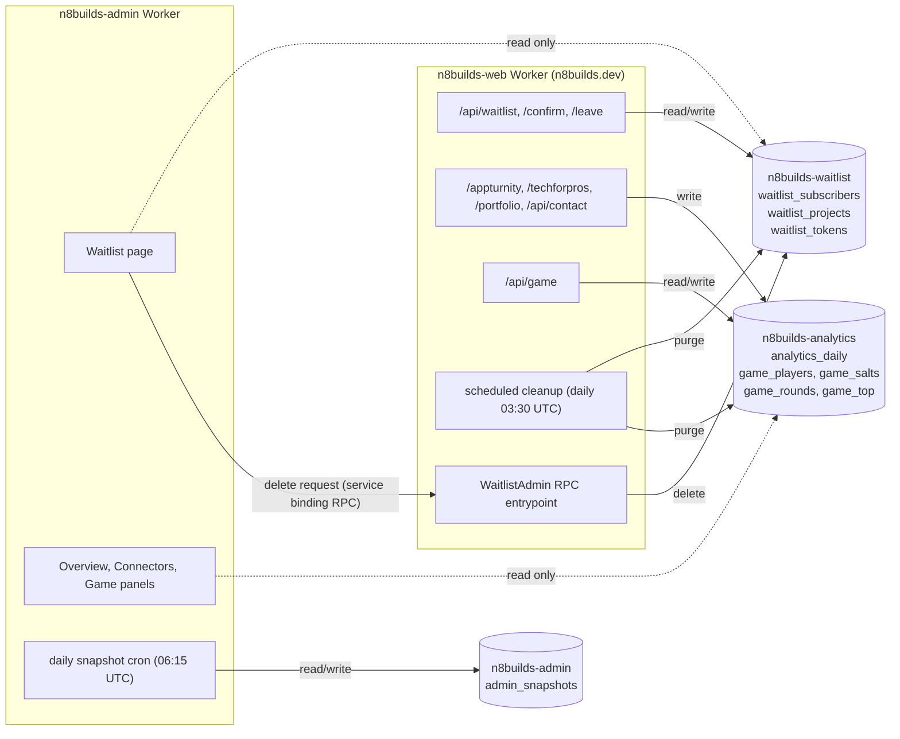

# Databases

n8builds keeps its own data in Cloudflare D1 (SQLite at the edge).
Upstash Redis is gone: the owner started fresh on D1 on 2026-11-04, and nothing was imported.

This file is the source of truth for the layout.
Change it in the same pull request as any migration or query that changes what it says.

## Owners and readers

Two words carry the whole design:

- The **owner** of a database is the one app whose repository defines its tables (holds and applies its migrations) and whose code writes to it.
  Each database has exactly one owner.
- A **reader** is an app that only queries a database: it never writes, and never changes the schema.

## The layout: one database per data owner and sensitivity

Data is split by who owns it and how sensitive it is, not by which screen shows it.

| Database | Binding | Holds | Owner | Readers |
| --- | --- | --- | --- | --- |
| `n8builds-waitlist` | `WAITLIST_DB` | personal data: the waitlist's addresses, projects, notes and hashed link tokens | n8builds-web (`migrations/waitlist/`) | n8builds-admin |
| `n8builds-analytics` | `ANALYTICS_DB` | anonymous counts: short-link clicks, contact messages sent, the dino game | n8builds-web (`migrations/analytics/`) | n8builds-admin |
| `n8builds-admin` | `ADMIN_DB` | the admin's own state: the daily snapshot of stars and Actions minutes | n8builds-admin (its `migrations/admin/`) | none |

## Architecture decision (owner-approved, 2026-11-04)

Three databases, `n8builds-waitlist`, `n8builds-analytics` and `n8builds-admin`, replacing the one Upstash Redis database that held everything.

- **One owner per database is the hard rule.**
  The admin dashboard writes its own daily snapshot, and n8builds-web writes everything else, so the admin's state can't share a database with n8builds-web's: that alone forces the `n8builds-admin` database.
- **The waitlist is split from the analytics**, though one Worker owns both:
  - Point-in-time restore (D1 Time Travel) works on a whole database.
    Restoring the counters must never bring back an address someone deleted, and restoring the waitlist must never rewind the counts.
  - The waitlist is shared product infrastructure, not n8builds.dev's own data: Feelium, KeysReady and the products after them collect their early users through it.
    It should be able to move, be exported or be handed to a product as a unit, without the site's counters attached.
  - Personal data gets its own export, deletion and retention, and an export of the counters can never contain an address.
  - The analytics and game code never needs the personal-data schema.
- **Cost is near zero.**
  D1 bills by rows read and written and by storage, not per database, and all three are far inside the free allowance.
- **What it does not buy.**
  n8builds-web's own code can still reach both of its databases (they are bound to the same Worker).
  And D1 can't make a binding read-only, so the admin's read-only access is a rule enforced in its code and tests, not by Cloudflare.
- **No copies.**
  The admin queries the source tables directly; nothing is duplicated into its own database.
- **Naming.**
  Each database belongs to n8builds alone (the account also has `open-ping`, `siteforge-hub` and `dead-link-db`), so table names only need to be unique inside it.
  Tables still carry their area as a prefix (`waitlist_`, `analytics_`, `game_`, `admin_`), so a query, a log line or an export always says where a row came from.

D1 can't make a binding read-only: any Worker bound to a database can write to it.
So the admin's read-only access is enforced in code and tests (see [Who may write](#who-may-write)).

## n8builds-waitlist

The `/upcoming` waitlist (double opt-in).
Its rules live in `lib/waitlist/store.ts`; the routes are `app/api/waitlist/**`.

### `waitlist_subscribers`: one row per address

| Column | Type | Notes |
| --- | --- | --- |
| `id` | `TEXT PRIMARY KEY` | first 32 hex characters of SHA-256 of the normalized address |
| `email` | `TEXT NOT NULL UNIQUE` | normalized: trimmed and lowercased, validated by `joinSchema` (at most 100 characters) |
| `note` | `TEXT NOT NULL DEFAULT ''` | the confirmed note (at most 500 characters) |
| `requested_note` | `TEXT NOT NULL DEFAULT ''` | a note waiting on the confirm link |
| `interest` | `TEXT NOT NULL DEFAULT ''` | the project slug the visitor arrived with (first touch) |
| `referrer` | `TEXT NOT NULL DEFAULT ''` | the page that sent them, origin and path only |
| `created_at`, `updated_at` | `TEXT NOT NULL` | ISO 8601, UTC |
| `confirmed_at` | `TEXT` | null until the first confirm |
| `expires_at` | `INTEGER` | epoch ms; set while unconfirmed (7 days after the latest join), null once confirmed |

Indexes: `created_at` (the admin's newest-first list), `expires_at` where not null (the cleanup).
Every column has a `CHECK` on its length, so nothing bigger than the form allows can be stored.

### `waitlist_projects`: one row per address and project

| Column | Type | Notes |
| --- | --- | --- |
| `subscriber_id` | `TEXT NOT NULL` | references `waitlist_subscribers(id) ON DELETE CASCADE` |
| `project` | `TEXT NOT NULL` | a slug from `data/upcoming.ts` (relink, strollz, vibelog, keysready, asset-arsenal, feelium) |
| `status` | `TEXT NOT NULL` | `CHECK (status IN ('requested', 'confirmed'))` |
| `requested_at` | `TEXT NOT NULL` | ISO 8601 |
| `confirmed_at` | `TEXT` | ISO 8601, null while requested |

`PRIMARY KEY (subscriber_id, project)`: an address is on a project's list at most once, however often the form is sent.
Index: `(project, status)` for the per-project counts.
A new project needs no migration: slugs are checked by the app (`isUpcomingSlug`), not by the table.

### `waitlist_tokens`: the secrets behind the emails' links

| Column | Type | Notes |
| --- | --- | --- |
| `token_hash` | `TEXT PRIMARY KEY` | SHA-256 (hex) of the link's random token; the token itself is never stored |
| `subscriber_id` | `TEXT NOT NULL` | references `waitlist_subscribers(id) ON DELETE CASCADE` |
| `purpose` | `TEXT NOT NULL` | `CHECK (purpose IN ('confirm', 'leave'))` |
| `created_at`, `expires_at` | `INTEGER NOT NULL` | epoch ms; confirm links last 7 days, leave links 365 days |
| `used_at` | `INTEGER` | set when a confirm link is used; a used link never works again |

Index: `subscriber_id`, `expires_at`.
A token is 24 random bytes (`crypto.randomBytes`), base64url, so an unsalted SHA-256 is enough: there is nothing to brute-force.
New links are made only when an email is about to go out, and each email gets its own pair.
A confirm token is single use; a leave token is used up by the leave itself, which deletes everything (cascade).

### How each write stays atomic

D1 runs a `batch()` as one transaction, and each statement below is a single transaction on its own.

- **Join**: one batch.
  It drops a stale unconfirmed row for the address (expired but not yet purged), upserts the subscriber (`INSERT ... ON CONFLICT(id) DO UPDATE`), and inserts each requested project with `ON CONFLICT DO NOTHING`, so two simultaneous joins can't create two rows or downgrade a confirmed project.
  The confirm and leave tokens are added in a second batch, and only when the confirm email is actually sent.
- **Confirm**: one batch.
  The first statement marks the token used only if it is a confirm token, unused and unexpired (`UPDATE ... WHERE used_at IS NULL AND expires_at > now`); the next two confirm the projects and the subscriber only for the token that statement just marked.
  A replayed or double-clicked link finds the token used and changes nothing.
- **Leave**: one statement, `DELETE FROM waitlist_subscribers WHERE id = (SELECT subscriber_id FROM waitlist_tokens WHERE token_hash = ? AND purpose = 'leave' AND expires_at > ?)`; the cascade removes the projects and tokens with it.
- **Admin delete** (a deletion request): the admin calls n8builds-web's `WaitlistAdmin.deleteSubscriber(id)` over a service binding, which runs one `DELETE` by id.

### Retention

- Confirmed entries are kept until the person leaves, or the owner deletes them (on request, or when a project launches and its list is used).
- Unconfirmed entries are hidden from every query once `expires_at` passes, and purged by the daily cleanup.
- Expired tokens and used confirm tokens are purged by the daily cleanup.
- Leaving deletes the row and everything with it at once, as the privacy page promises, so no "left" timestamp is kept.

### The newsletter: `newsletter_subscribers`, `newsletter_digests`, `newsletter_deliveries`

The blog newsletter (N8's Notions by email, double opt-in), in the same database but in its own tables (`migrations/waitlist/0002_newsletter.sql`), so unsubscribing never touches the waitlist and leaving the waitlist never touches the newsletter.
Its rules live in `lib/newsletter/store.ts` and `lib/newsletter/digest.ts`; the routes are `app/api/newsletter/**`, the pages `app/newsletter/**`.

- `newsletter_subscribers`: one row per address (`id` is the first 32 hex characters of the SHA-256 of the address, as the waitlist's).
  `confirm_hash` holds the SHA-256 of the newest confirm link's token, cleared when it is used, so a confirm link works once; a new sign-up replaces it.
  Unconfirmed rows carry `expires_at` (7 days after the last confirm email); confirmed ones have `confirmed_at` instead.
  `unsubscribe_token` is kept as is, because every digest needs it for its links and headers; all it can do is delete its own row.
- `newsletter_digests`: one row per weekly digest, with the posts it carries and its status (`sending`, `sent`, `skipped`), the number of recipients, and a note for the owner when it was skipped or paused. No personal data.
- `newsletter_deliveries`: which subscriber has had which digest, so a run that stops at a mailroom refusal resumes where it left off.

Email goes through mailroom as the app `n8builds-news` (`MAILROOM_NEWS`): 40 a day, 150 a month, 3 per address a day.
The weekly cron (Thursday 16:00 UTC) starts a digest only when a post was published since the last one, and skips the week (status `skipped`, a warning in the logs and Sentry) when the month's digests would pass 120 emails, keeping 30 of the 150 for confirm emails.
Each run sends at most 30 and stops at the first refusal; the daily cron finishes an unfinished digest.
An address mailroom has suppressed (a bounce or a complaint) is deleted.

Retention: unconfirmed rows are purged by the daily cleanup once `expires_at` passes, unsubscribing deletes the row and its deliveries at once, and deliveries are purged 30 days after their digest finished.

## n8builds-analytics

Anonymous counts only: no IP address, user agent, cookie or email is ever written here.

### `analytics_daily`: every daily counter

| Column | Type | Notes |
| --- | --- | --- |
| `metric` | `TEXT NOT NULL` | `ref:appturnity`, `ref:techforpros`, `ref:portfolio`, `contact:sent`, `game:rounds`, `game:scores`, `game:countries`, `game:regions` |
| `day` | `TEXT NOT NULL` | UTC `YYYY-MM-DD` |
| `field` | `TEXT NOT NULL DEFAULT ''` | the link placement (`navbar`, `footer`...), `start:<site>`/`end:<site>`, a score, a country or region code; `''` for a plain count |
| `count` | `INTEGER NOT NULL` | `CHECK (count >= 0)` |

`PRIMARY KEY (metric, day, field)`, `WITHOUT ROWID`; index on `day` for the cleanup.
Every increment is one upsert: `INSERT ... VALUES (?, ?, ?, 1) ON CONFLICT DO UPDATE SET count = count + 1`, so concurrent clicks never lose a count.

### The dino game

What is kept, and why it is private, is explained at the top of `lib/game/stats.ts`.

| Table | Columns | Keys | Kept |
| --- | --- | --- | --- |
| `game_salts` | `day TEXT`, `salt TEXT` | `PRIMARY KEY (day)` | 2 days |
| `game_players` | `day TEXT`, `site TEXT`, `player TEXT`, `rounds INTEGER` | `PRIMARY KEY (day, site, player)` | `KEEP_DAYS` (400) |
| `game_rounds` | `id TEXT`, `player TEXT`, `site TEXT`, `country TEXT`, `started_at INTEGER`, `expires_at INTEGER` | `PRIMARY KEY (id)`, index on `expires_at` | 1 hour |
| `game_top` | `round_id TEXT`, `score INTEGER`, `site TEXT`, `country TEXT`, `day TEXT` | `PRIMARY KEY (round_id)`, index on `score` | the best 50, for good |

`player` is a hash of (the day's random salt, IP, user agent); the salt is deleted after two days, so a hash can't be traced back or linked across days.
`site` is `CHECK (site IN ('n8builds', 'portfolio'))`.
A finished round is consumed with `DELETE ... RETURNING`, so it counts at most once.

### Retention

Counter and player rows older than `KEEP_DAYS` (400, `lib/game/stats.ts`) are deleted by the daily cleanup; old salts and finished-or-abandoned rounds too.
Readers only ask for the last 30 days, so a late cleanup never shows stale data.

## n8builds-admin

Owned and migrated by n8builds-admin; see its `docs/DATABASE.md`.
One table, `admin_snapshots (day TEXT PRIMARY KEY, data TEXT NOT NULL, created_at TEXT NOT NULL)`: the daily stars and Actions minutes as JSON, kept 400 days and pruned by the same cron that writes them.
It holds no visitor data.

## Who may write

- **n8builds-web** is the only writer of `n8builds-waitlist` and `n8builds-analytics`, and the only repository with their migrations.
- **n8builds-admin** binds both read-only by convention, and the convention is enforced:
  its `lib/db.ts` hands out a wrapper that refuses any statement that isn't a single `SELECT` (or `WITH ... SELECT`), and `tests/unit/db-read-only.test.ts` fails if any admin reader writes, changes a row, or if any other file reaches the raw bindings.
  The one write the admin needs, deleting an address on request, goes through n8builds-web's `WaitlistAdmin` RPC entrypoint (a service binding, never reachable from the internet).
- Every query in both repositories is a prepared statement with bound parameters: no value ever becomes part of the SQL text.
  The only text put into SQL is constant fragments in the same file, and, in test helpers, table names read from `sqlite_master`.

## Migrations

- Files: `migrations/waitlist/NNNN_*.sql` and `migrations/analytics/NNNN_*.sql` in n8builds-web, numbered, never edited once applied; a change is a new file.
- Applied with `npx wrangler d1 migrations apply <database> --remote` (`npm run db:migrate`), which records what ran in each database's `d1_migrations` table and applies only the new ones.
- Who runs them: the Deploy workflow applies them before deploying when the repository variable `D1_MIGRATE` is `1` (its `CLOUDFLARE_API_TOKEN` then needs the `D1: Edit` permission).
  Until then the owner, or an agent on the owner's logged-in wrangler, runs `npm run db:migrate` before merging a pull request that adds a migration.
- n8builds-admin's `migrations/admin/` are applied the same way from that repository (`npm run db:migrate` there).
  Its tests and local setup load a copy of this repository's schema (`tests/fixtures/web-schema/`), which is never applied to a real database.
- Migrations must be backward compatible with the code that is live while they run (add columns and tables first, drop later), because they land before the new Worker.

## Backups and restore

- D1 Time Travel keeps every database restorable to any minute of the last 30 days (7 on the Workers Free plan), with no setup.
  `npx wrangler d1 time-travel info n8builds-waitlist` shows the current bookmark; `npx wrangler d1 time-travel restore n8builds-waitlist --timestamp=<ISO time>` restores the whole database.
  Restoring the waitlist can bring back people who left since: after a restore, ask whether any leave or deletion happened in between and repeat it.
- A copy: `npx wrangler d1 export <database> --remote --output <file>.sql`.
  An export of `n8builds-waitlist` is personal data: keep it off shared drives and delete it when done.

## Local development and tests

- `next dev`, `next start` and the build reach D1 through OpenNext's `getCloudflareContext({ async: true })`, which runs wrangler's local simulation (Miniflare, kept in `.wrangler/state`).
  Run `npm run db:migrate:local` once (and after pulling a new migration); without the tables, the waitlist answers "unavailable" and counters are skipped.
- Unit tests run every query against fresh in-memory D1 databases from wrangler's `getPlatformProxy` (the same simulation), with the real migrations applied (`tests/unit/d1.ts`).
- Playwright's server runs `npm run db:migrate:local` before it starts, and the waitlist flow spec (`tests/e2e/upcoming.spec.ts`) signs up through the form, confirms and leaves through the emailed links, against the real routes and SQL.
  In `CONTACT_TEST_MODE` nothing is emailed: the would-be emails are kept in memory and served by `/api/test/outbox`, which answers 404 outside test mode (and test mode is ignored on any deployed Worker).

## Threats and what stops them

| Threat | Defence |
| --- | --- |
| Finding out whether an address is on the list | Join and "email me a leave link" give the same answer for new, pending and confirmed addresses; the leave link is sent after the response, so timing doesn't tell either. |
| Signing someone else up | Double opt-in: nothing counts until the confirm link sent to that address is clicked. |
| Guessing a link token | 192 random bits; only the SHA-256 is stored, so a leaked database or export holds no working link. Links expire (7 days to confirm, 365 to leave). |
| Replaying a confirm link | Single use: the token is marked used in the same transaction that confirms. |
| Flooding the form or inboxes | Turnstile on every form post (joining, and asking for a leave link), 5 requests an hour per IP (IPv6 per /64) on every waitlist route, a site-wide daily cap on waitlist emails, and at most 3 waitlist emails per address a day. The confirm and leave buttons carry a link's secret token instead of a Turnstile check. |
| Stuffing the counters (ballot-style spam) | Short-link clicks are counted at most 20 times an hour per IP (in a Durable Object, the IP never stored) and bots are skipped; contact sends count only after Turnstile and the form's limits; game rounds are limited per player and per IP, and a score counts only for a round started 29 or more seconds earlier, at most 60. |
| SQL injection | Prepared statements with bound parameters only. |
| Reading or deleting someone else's entry (IDOR) | No public route takes an entry id: the public ones take a secret token. The admin's list and delete sit behind its GitHub sign-in, and the delete is an RPC on a service binding. |
| Bulk export of personal data | Only the owner's Cloudflare account and the admin dashboard (behind sign-in) can read `n8builds-waitlist`; exports are a deliberate wrangler command. |
| Personal data in logs | Routes log error messages only, never addresses, notes or tokens; Sentry scrubs request bodies (`lib/sentry-scrub.ts`). |
